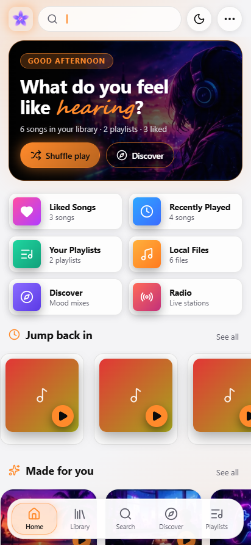

<div align="center">


# Vanilla Music

### Music that moves with you.

A free music player for **Windows**, **macOS** and **Android** - your own library and YouTube in one place, with big **full-screen synced lyrics** and a tiny **mini player**.

[**Download**](../../releases/latest) &nbsp;•&nbsp; [**Discord**](https://discord.gg/weRFDT6Ppf) &nbsp;•&nbsp; [**Website**](https://vanilla-music.netlify.app)

</div>

---

## Screenshots

<p align="center">
  
</p>
<p align="center">
  
  
</p>
<p align="center">
  
  
  
</p>

## Features

| | |
|---|---|
| **Library + YouTube** | Add songs or folders, or search any song on YouTube and play it right away. Drag & drop works. |
| **Full-screen lyrics** | Press `L` (or the mic button) for big synced lyrics. Tap a line to jump to it. |
| **Mini player** | Shrink the app into a small always-on-top player (Windows & Mac). |
| **Now Playing card** | Cover, title and play/pause in the sidebar - click it to open lyrics. |
| **Download songs** | Save YouTube songs as audio files. |
| **AI DJ & mixes** | Mood mixes and a smart shuffle made from your own library (all local). |
| **Playlists, liked songs, radio** | Always one tap away. |
| **Themes** | Dark or light, 9 accent colours, fonts, roundness and density. Default: dark + orange (white + orange on Android). |
| **Android extras** | Background play, lock-screen controls, long-press shortcuts (*About developer*, *Search songs*). |

## Download

Get the latest build from the [**Releases**](../../releases/latest) page:

- **Windows** - `Vanilla-Music-<version>-Windows-x64.exe` (installer) or `...-Windows-Portable.exe`
- **Android** - `Vanilla-Music-<version>-Android.apk` (allow *Install unknown apps* when asked)
- **macOS** - build from source (see below) until a `.dmg` is attached

> Windows may show a SmartScreen notice because the installer is not code-signed yet: **More info -> Run anyway**.

## Build from source

```bash
npm install
npm run dev          # desktop app in development
npm run dist:win     # Windows installer + portable
npm run dist:mac     # macOS dmg + zip (run this on a Mac)
npm run android:apk  # debug APK (needs JDK 21 + Android SDK)
```

Tech: Electron, React 19, Vite, Capacitor 8 (Android), NewPipe Extractor, yt-dlp, LRCLIB lyrics.

## Shortcuts

`Space` play/pause · `L` lyrics · `S` shuffle · `M` mute · `←/→` seek · `Shift+←/→` previous/next · `Ctrl+K` search

## Privacy

No accounts, no ads, no analytics. Your library stays on your device. The app goes online only for YouTube and lyrics.

## Community

Join the [Discord](https://discord.gg/weRFDT6Ppf) for help, ideas and updates.

## Licence

Proprietary - free for personal, non-commercial use. Third-party components keep their own licences (Electron, React, Vite, Capacitor, NewPipe Extractor, Lucide, music-metadata, yt-dlp). Lyrics from LRCLIB.

Made with love by **Ashborn**.
