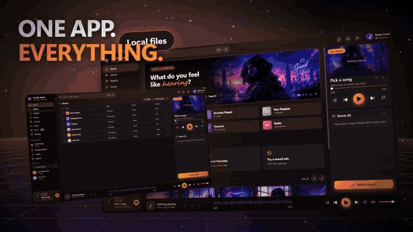
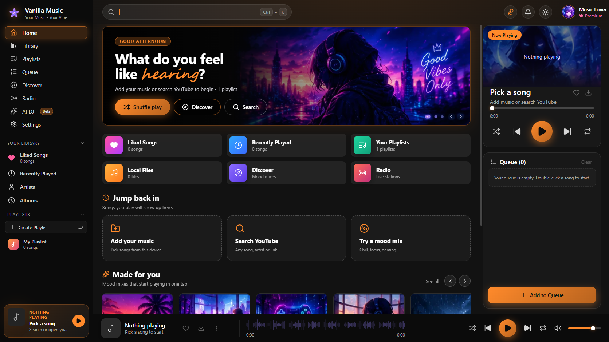
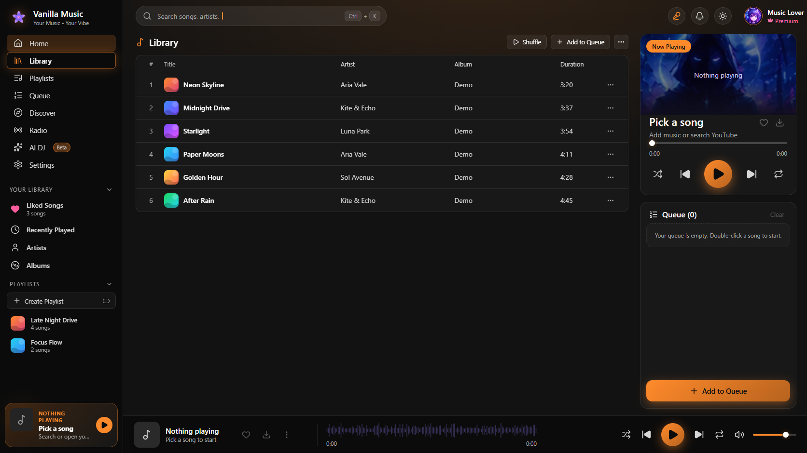
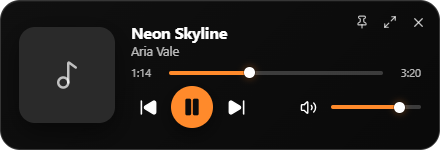
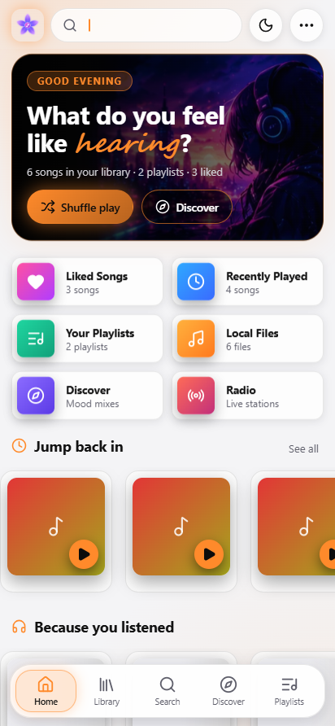
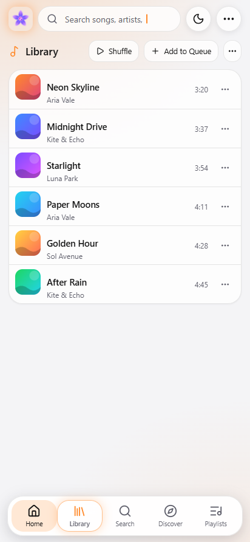
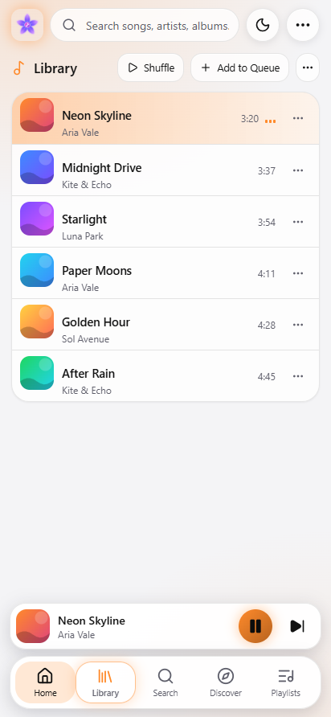

 

  

## ✨ See it in action

  
   
  Desktop app → full-screen lyrics → mini player (cut from the 44-second promo video)

 

  

<table>
  <tr>
    <td width="50%"> <b>Library</b> - your files and every download, with a Now Playing card</td>
    <td width="50%" align="center"> <b>Mini player</b> - tiny, always on top (Windows &amp; Mac)</td>
  </tr>
</table>

  
  
  
   <b>Android</b> - white &amp; orange by default, background play with lock-screen controls

## 🚀 Features

| | Feature | What you get |
|:-:|---|---|
| 🎵 | **Library + YouTube** | Add songs or folders (drag & drop works) or search any song on YouTube and play it instantly. |
| 🎤 | **Full-screen lyrics** | Big synced lines that glow with the song, cover-colour backdrop, tap a line to seek. Press <kbd>L</kbd>. |
| 🔎 | **Lyrics almost everywhere** | Smart title cleaning, then LRCLIB → NetEase → lyrics.ovh, so far fewer "not found". |
| 🪟 | **Mini player** | The whole app shrinks into a small always-on-top player with seek, volume and controls. |
| ⬇️ | **Downloads → library** | Save a YouTube song and it lands in **Library → Local files** automatically, ready offline. |
| 🔥 | **A busy Home** | *Because you listened*, *Trending now*, *Hot in India*, mood mixes, radio. |
| ✨ | **AI DJ & mixes** | Local smart shuffle and mood mixes - nothing is sent to an AI service. |
| 🎨 | **17 looks** | AMOLED, Midnight, Ocean, Forest, Rose, Sunset, Mocha, Nord, Dracula, Neon, Paper, Cream, Mint, Sky, Lavender, Peach + 17 accent colours. |
| 🔋 | **Android background play** | Foreground service, wake & Wi-Fi locks, lock-screen controls, battery-optimisation helper. |
| 🔒 | **Private by design** | No account, no ads, no analytics. Your library stays on your device. |

<b>🎹 Keyboard shortcuts</b>

 

| Key | Action | Key | Action |
|---|---|---|---|
| <kbd>Space</kbd> | Play / pause | <kbd>L</kbd> | Full-screen lyrics |
| <kbd>←</kbd> <kbd>→</kbd> | Seek 5 s | <kbd>Shift</kbd>+<kbd>←</kbd>/<kbd>→</kbd> | Previous / next |
| <kbd>↑</kbd> <kbd>↓</kbd> | Volume | <kbd>M</kbd> | Mute |
| <kbd>S</kbd> | Shuffle | <kbd>Ctrl</kbd>+<kbd>K</kbd> | Search |

## ⬇️ Download

| Platform | File | Notes |
|:-:|---|---|
| 🪟 **Windows** | `Vanilla-Music-<version>-Windows-x64.exe` · `...-Windows-Portable.exe` | Windows 10/11, 64-bit. Custom setup wizard. |
| 🤖 **Android** | `Vanilla-Music-<version>-Android.apk` | Android 8+. Allow *Install unknown apps* when asked. |
| 🍎 **macOS** | `...-macOS-arm64.dmg` · `...-macOS-x64.dmg` | Coming soon - or build it yourself, see below. |

👉 **Get them from the [Releases page](../../releases/latest).**

👉 **Get them from the [Website](https://vanilla-music.netlify.app/).**

> [!NOTE]
> The apps are not code-signed yet. Windows shows a SmartScreen notice once - click **More info → Run anyway**. On a Mac, right-click the app → **Open** (or run `xattr -cr "/Applications/Vanilla Music.app"`).

## 🗺️ Roadmap

- [x] Full-screen synced lyrics
- [x] Mini player (Windows & Mac)
- [x] Downloads added to the library automatically
- [x] Multi-source lyrics + smart title cleaning
- [x] 17 looks, Trending & "Because you listened"
- [x] Rebuilt Android background play
- [ ] Ready-made macOS `.dmg` on the Releases page
- [ ] Code-signed Windows installer
- [ ] iOS
- [ ] Manual lyrics (paste / `.lrc` file)
- [ ] Sleep timer & equalizer

Have an idea? Tell us on **[Discord](https://discord.gg/weRFDT6Ppf)** or open an issue.

## ❓ FAQ

<b>Where do my downloads go?</b>

 Windows/Mac: <code>Music\Vanilla Music</code>. Android: <code>Music/Vanilla Music</code>. They are also added to <b>Library → Local files</b> automatically.

<b>Music stops with the screen off on Android</b>

 Open <b>Settings → Background play → Allow</b> and, on phones with strict battery savers (Xiaomi, Oppo, Vivo, Samsung), set the app's battery to "No restrictions".

<b>Lyrics are missing for a song</b>

 The app searches LRCLIB, NetEase and lyrics.ovh. If none has it you will see "No lyrics found".

<b>Is it really free? Where does the music come from?</b>

 Yes - free, no ads. Vanilla Music plays files you own and public YouTube content you choose. It does not host any music.

## 🔐 Privacy

No accounts, no ads, no analytics. The library, playlists and settings stay on your device. The app goes online only for YouTube and lyrics. Full details: [Privacy Policy](https://vanilla-music.netlify.app/privacy.html).

## 📜 Licence & credits

Proprietary - free for personal, non-commercial use (see [`LICENSE`](LICENSE)). Built with Electron, React, Vite, Capacitor, [NewPipe Extractor](https://github.com/TeamNewPipe/NewPipeExtractor), [yt-dlp](https://github.com/yt-dlp/yt-dlp), Lucide icons and music-metadata. Lyrics from [LRCLIB](https://lrclib.net). YouTube is a trademark of Google LLC; this project is not affiliated with YouTube or Google.

**Made with ♥ by [Ashborn](https://github.com/ashbornofficial)** · [Discord](https://discord.gg/weRFDT6Ppf)

If you like it, drop a ⭐ on the repo - it really helps.

